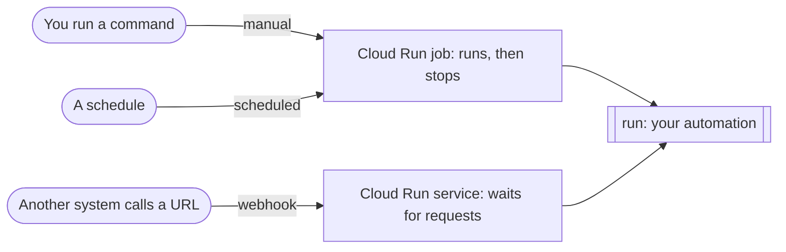

# Advanced AI Automation

The code for the Advanced AI Automation Full Course 2027. Business automations written in Python, built with Claude Code and Codex, and run on Google Cloud Run.

Five examples. The first three are hello world, started three different ways. The last two are real automations a business would pay for.

## The idea

An automation is a function called `run`. The last line of the file says what starts it.

```python
from toolkit import triggers

def run() -> dict:
    return {"message": "Hello, world!"}

if __name__ == "__main__":
    triggers.job(run)        # or: triggers.webhook(run)
```



## The examples

Read them in order. Each one adds one idea.

| File | What it does | Trigger | AI |
|---|---|---|---|
| [`01_manual.py`](automations/01_manual.py) | Says hello | Manual | None |
| [`02_scheduled.py`](automations/02_scheduled.py) | Says hello, every 5 minutes | Schedule | None |
| [`03_webhook.py`](automations/03_webhook.py) | Says hello to whoever calls it with the right token | Webhook | None |
| [`04_daily_research.py`](automations/04_daily_research.py) | Every weekday at 7am, finds companies in your market that just raised money, hired a leader or opened a site, and adds them to the sales sheet | Schedule | One call per signal |
| [`05_speed_to_lead.py`](automations/05_speed_to_lead.py) | When a website enquiry arrives, tells the team in Slack, emails the prospect a proposal from your price list within a minute, and saves the lead | Webhook, signed | One call |

### Why these two

Both are automations businesses already pay people to do by hand, and both are mostly fixed steps with one step that needs judgment. That is where code beats an agent: the code decides what's new, what's safe to send and what gets saved, and the model only does the reading or the writing.

- **Daily research.** A company that just showed a buying signal is a far better lead than one from a list. The code removes duplicates and refuses rows with no source link, so the model can't add a repeat or a made up company.
- **Speed to lead.** The first company to reply to an enquiry has a big head start, and most reply hours later. The proposal may only offer what's in [`services.md`](automations/services.md), and plain code checks every price in it before anything is sent. If the model fails, the team is still told and the lead is still saved.

## The toolkit

[`automations/toolkit/`](automations/toolkit/) is the shared code. One idea per file.

| File | What it gives you |
|---|---|
| [`triggers.py`](automations/toolkit/triggers.py) | `triggers.job(run)` and `triggers.webhook(run)`, with a token or a signature check. One JSON log line per run |
| [`shadow.py`](automations/toolkit/shadow.py) | Shadow mode: everything runs and nothing is sent. On unless `SHADOW=false` |
| [`retry.py`](automations/toolkit/retry.py) | Tries a call again on a temporary failure, waiting longer each time |
| [`ai.py`](automations/toolkit/ai.py) | `ai.ask(prompt, shape=..., search=...)`: one call to Gemini on Vertex AI, in the region you pick |
| [`sheets.py`](automations/toolkit/sheets.py) | `sheets.read(tab)` and `sheets.add(tab, row)` |
| [`slack.py`](automations/toolkit/slack.py) | `slack.post(text)` |
| [`mail.py`](automations/toolkit/mail.py) | `mail.send(to, subject, text, key)` through Resend, safe to retry |

## Get started

You need a Google Cloud project with billing on, the [gcloud CLI](https://cloud.google.com/sdk/docs/install) and [uv](https://docs.astral.sh/uv/).

1. Get the code and create your settings file.

```
git clone https://github.com/the-ai-engineer/workshops.git
cd workshops/ai-automation-course
cp .env.example .env
```

2. Fill in `.env`. Make a Google Sheet with two tabs, `Prospects` and `Leads`, and put its id in `SHEET_ID`.

3. Run the tests. They use fakes, so they need no Google account.

```
uv run pytest
```

4. Run hello world on your laptop.

```
uv run python automations/01_manual.py
```

5. Sign in and deploy. The first run takes a few minutes.

```
gcloud auth login
gcloud config set project your-project-id
./deploy.sh
```

The script turns on the services, creates the `automations` service account and a second one that only builds the image, puts your secrets in Secret Manager, builds one image, deploys every automation and creates the schedules. At the end it prints a command to try each one, and the service account's email. Share your sheet with that email as Editor.

6. Get an email when anything fails.

```
ALERT_EMAIL=you@example.com ./alerts.sh
```

## Run the demos

[DEMO.md](DEMO.md) has every demo from the course in order, on your laptop and on Google Cloud, with the commands to copy.

## Going live

Everything starts in shadow mode. Run it on real data, read the `"would"` lines in the logs, and when you're happy set `SHADOW=false` in `.env` and run `./deploy.sh` again.

## Credentials

There are no keys for Google. Each automation runs as the `automations` service account, which can call Gemini on Vertex AI and can only open the sheets you share with it.

Four secrets belong to other companies or to you: the webhook token, the webhook signing secret, the Slack webhook address and the Resend key. `deploy.sh` copies them from `.env` into Secret Manager, and Cloud Run hands them to the automation when it starts. `.env` is in `.gitignore`. Never commit it.

## Other ways to do this

A job on Cloud Run with a scheduler is one way to run an automation. These are the others worth knowing.

| Kind | Options | Reach for it when |
|---|---|---|
| The same idea on another cloud | [AWS Lambda](https://docs.aws.amazon.com/lambda/latest/dg/welcome.html) with [EventBridge Scheduler](https://docs.aws.amazon.com/scheduler/latest/UserGuide/what-is-scheduler.html), [Azure Container Apps jobs](https://learn.microsoft.com/en-us/azure/container-apps/jobs) | The business is on AWS or Azure. A Lambda function is stopped at 15 minutes |
| Workflow services: the steps go in a config file | [Google Cloud Workflows](https://docs.cloud.google.com/workflows/docs/overview), [AWS Step Functions](https://docs.aws.amazon.com/step-functions/latest/dg/welcome.html), [Azure Logic Apps](https://learn.microsoft.com/en-us/azure/logic-apps/logic-apps-overview) | A run has to wait hours or days for a person or another system |
| Durable execution: the steps are code, saved as they finish | [Temporal](https://temporal.io/), [Inngest](https://www.inngest.com/), [Trigger.dev](https://trigger.dev/), [Cloudflare Workflows](https://developers.cloudflare.com/workflows/) | A long process should carry on from the step that failed |
| Data pipeline schedulers | [Apache Airflow](https://airflow.apache.org/), [Prefect](https://www.prefect.io/) | You have dozens of jobs that feed each other |

The examples here need none of them. Each is one short job that is safe to run twice. Add one when a run has to wait, or has to pick up where it left off.
