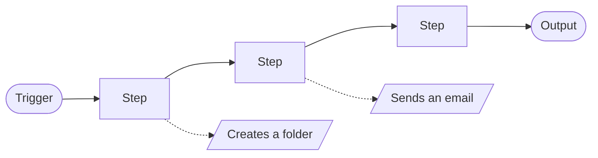
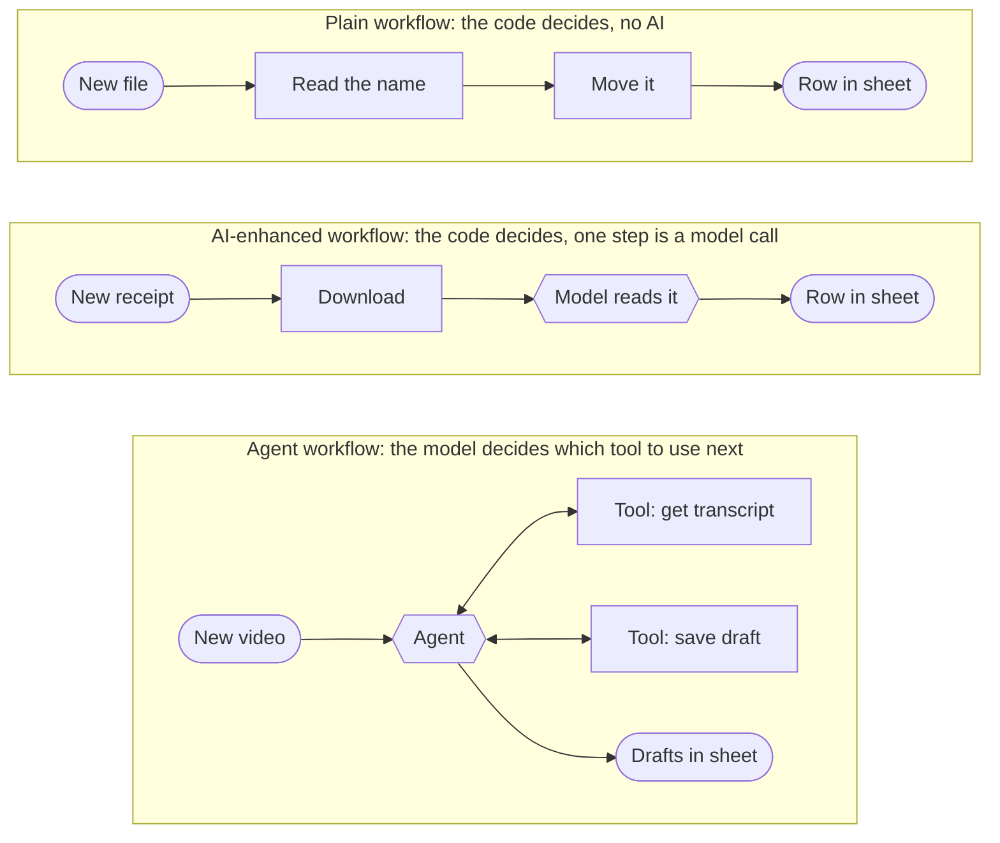
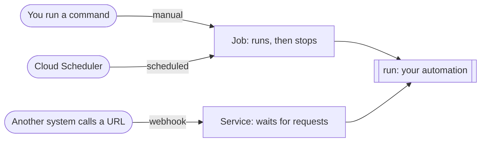
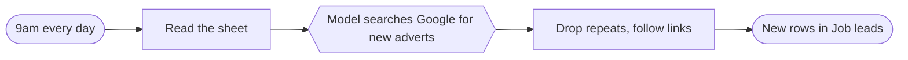

# Professional AI Automations: full course outline

The flow for the YouTube course, built from the rough outline. Each chapter has the points to make and, where there is a demo, the file to show. The step-by-step commands for the demos are in [WORKSHOP.md](WORKSHOP.md).

Things still to decide are marked **Decide**. Things not built yet are marked **To build**.

## 1. Introduction

- In this course we build business automations like the ones people make in n8n, but in code.
- I'll show you how I build them professionally, for real clients.
- There are no right answers here. This is how I do it and why.
- **What "professional" means.** Working on your machine is not the same as running reliably for a business. Professional means: it runs at scale (thousands of runs a day), it survives failure (retries and error handling), you can see what it's doing (logs and metrics), it tells you when it breaks (alerts), it is secure, and it is easy to maintain.
- What you will have at the end: a handful of working automations on Google Cloud, and a way to decide how to build the next one.

## 2. What is a business automation, and why it matters

- It takes a repeatable process and has a computer do it: research, moving files, generating assets, scanning invoices into a folder.
- Every automation has the same shape: something starts it, a few steps run, something comes out. Along the way, the steps change things in the outside world.



- **Side effect:** anything a step changes outside the automation, such as a folder created, an email sent, a row added or a card charged. The output is what the automation is for. Side effects are everything else it touches on the way.
- Side effects are why automations need care. If a run fails halfway and you run it again, step one has already happened. So a step with a side effect checks before it acts.

- **Quality and consistency.** People forget steps. An automation does the same thing every time.
- **Less friction.** The task stops depending on someone finding the time and remembering how.
- **It runs 24/7.**
- None of this is new. Software teams have automated builds and deploys for decades. You click a button and a long, careful series of steps runs for you. Compare that with remembering a hundred shell commands.
- **Another lens: it simplifies complexity.** An automation is an abstraction. A script turns fifty manual steps that someone had to remember into one command, and one command is far easier to understand. Most automations chain steps that must run in order. Building the automation is building the one button, and you can trust it to run the same way every time.
- **Leverage.** Automate something that eats a team's time and the value multiplies. It is one of the fastest ways to get noticed as an engineer.

**Quotes to put on screen** (check the wording before publishing, these are from memory)

- Alfred North Whitehead, *An Introduction to Mathematics* (1911): "Civilization advances by extending the number of important operations which we can perform without thinking about them." Good for the opening.
- Bill Gates, widely attributed, *The Road Ahead* (1995): automation applied to an efficient operation magnifies the efficiency, and applied to an inefficient operation it magnifies the inefficiency. Good before "what should you automate".
- Larry Wall, *Programming Perl*: the three virtues of a programmer are "laziness, impatience and hubris". Good for the "a script is an automation" chapter.

## 3. The three types of workflow

| Type | What it is | Example | In the repo |
|---|---|---|---|
| Plain workflow | Fixed steps, no AI. Step A, step B, step C. | Fetch an invoice from Drive, process it, add it to a sheet | `00-contract_filing.py` |
| AI-enhanced workflow | Fixed steps, and one step is a call to a model | A model reads the invoice and returns the fields as structured data | `01-lead_research.py` |
| Agent workflow | An agent with tools decides the steps | The agent can download files and edit sheets, and works out what to do | `03-video_to_content.py` |



- An AI-enhanced workflow is not an agent. It is one model call with a known input and a known output.
- You can mix them: fixed steps with one agent step in the middle. That is `02-call_notes.py`.

**The trade-off**

- Agents are flexible. They can correct themselves and handle cases you did not plan for.
- They can make the logic much simpler. A traditional workflow with lots of branches and loops (the huge n8n graphs people post online) is hard to maintain. An agent absorbs most of that branching.
- The cost: an agent run uses more tokens, takes longer, and can take a different path each time. So it is harder to test and harder to promise a result.
- Rule of thumb: fixed steps when the path never changes, an agent when the path depends on what arrives.

Naming note: the rough outline called the first type a "manual workflow". That clashes with "manual trigger" in module 1, so this uses "plain workflow".

## 4. Where to build: no-code or code first

- **No-code platforms:** n8n, Zapier, Make. You draw the steps. Good if you are not technical, and the customer can read and edit the result.
- **Where visual tools get hard.** Past a certain size the picture stops helping. The "n8n spaghetti" with hundreds of nodes is hard to maintain, debug and manage. Branching pushes a workflow there, and so do retries and error handling, which a robust automation needs. In code each of those is a few lines.
- You can use Claude Code to build the n8n workflow for you. That gets you started faster, but the graph still gets out of hand as the logic grows.
- **Code first:** a script. This is what engineers have always done with a repeated task. We are lazy, and a script makes it repeatable.
- A workflow maps to a script with a few if/else statements. Real business workflows are mostly simple: move data, process data. The giant graphs on Instagram are not what most businesses need.
- Any language works: shell, Python, Ruby, TypeScript. This course uses Python because it is easy to read.

**Handle this objection early: the four ways to automate**

| Option | Best when | Runs without you | A team can see and control it | Same result every time | Cost at high volume |
|---|---|---|---|---|---|
| Agent on your machine (Claude Code with a skill) | It's just you, and you do the task now and then | No | No | Mostly | High |
| Hosted agent (a tool like Grok Bot) | It's just you, and you want it to run by itself | Yes | Limited | Mostly | High |
| No-code tool (n8n, Zapier) | You're not technical, or the customer wants to edit it | Yes | Yes, as a picture | Yes | Priced per run, or a server to look after |
| Code first (this course) | It runs often and a business depends on it | Yes | Yes: version history, logs, alerts | Yes | Close to nothing for plain code |

- Start by doing the task with an agent on your own machine. To run without you, it has to move to the cloud. When a team or a client depends on it, make it code.
- Why not an agent for everything? Agents are not fully repeatable (less of a problem than a year ago, but still true), and they get expensive at scale. At 30,000 runs a day you want plain code, not an agent or a model call.

## 5. The AI part

- For model calls and agents this course uses Gemini on Vertex AI. There are no API keys: the code signs in as its service account.
- A model call is one function: [`ai.ask`](examples/toolkit/ai.py). Give it a prompt, and optionally the shape of the answer you want and permission to search Google.
- An agent is a loop: the model picks a tool, the code runs it, repeat.

**Decided:** agents use Google's ADK, since everything else is on Google Cloud. It replaces the hand-written loop. **To build:** the ADK version, checked live.

## 6. Where to run it: Cloud Run

- I put the script in a container and deploy it to Cloud Run. AWS Lambda and others do the same job.
- **Scales to zero.** Nothing runs between triggers, so small automations cost close to nothing.
- **Scales up by itself.** A thousand runs need no extra work from you. (Avoid saying "infinitely": there are quotas.)
- **Logs, metrics and alerts are built in.** (Avoid saying "for free": there is a free allowance, then you pay.)
- This is the part that makes it professional. An automation that breaks without you knowing is worse than no automation. You need to be told, and you need logs to find out why.
- **The model comes from your cloud provider.** Gemini runs through Vertex AI, inside Google Cloud: the same sign-in, permissions and region as everything else, no API key, and no new supplier for the client to approve. Amazon and Microsoft offer the same on their clouds.
- **Billing per client.** One Google Cloud project per client splits the bill per client, compute and model calls together. Labels on each job break it down by automation, and the token counts in the logs show what one run costs. Useful when you charge clients for automations.
- It covers all three triggers: run a job by hand, put a job on a schedule, or run a service that waits for a webhook.
- A **job** starts, does the work and stops. A **service** waits for requests.

## 7. Module 1: triggers

How an automation starts is separate from what it does. So the first examples do nothing but say hello. No AI, no Drive, nothing to set up.



**The one rule that makes every example look the same:** an automation is a function called `run`. The last line of the file picks the trigger.

```python
from toolkit import triggers

def run() -> dict:
    return {"message": "Hello, world!"}

if __name__ == "__main__":
    triggers.job(run)        # or: triggers.webhook(run)
```

| # | Trigger | What starts it | Example | File |
|---|---|---|---|---|
| 1 | Manual | You run a command or click a button | `gcloud run jobs execute example-hello` | [`examples/01-hello_job.py`](examples/01-hello_job.py) |
| 2 | Scheduled | The clock | Cloud Scheduler runs the job every 5 minutes | the same file |
| 3 | Webhook | Another system sends an HTTP request | `curl` the URL with a token | [`examples/02-hello_webhook.py`](examples/02-hello_webhook.py) |

- Examples 1 and 2 are the same script. Nothing in the code knows which trigger fired. That is the lesson: the trigger is part of the deployment, the logic is in the script.
- Example 3 is different code because it is a different kind of thing: a **service** that waits for requests, where a **job** starts, works and stops.
- Module 2 keeps this shape and fills in `run`.

**What about events, like a file upload or a new email?**

They are not a fourth kind of trigger. An event reaches your code in one of two ways: the other system sends a webhook, or a scheduled job checks for what is new.

| Event | Can it push to you? | What it takes | Simple version |
|---|---|---|---|
| File added to Google Drive | Yes | You register a "watch" that Drive calls. It expires within a week and must be renewed, and the call only says "something changed", so you still ask Drive what | A job every few minutes that lists the folder. This is what the Drive examples do |
| Email arrives in Gmail | Not directly | Gmail publishes to Pub/Sub, Pub/Sub calls your service. Needs OAuth access to the mailbox and a watch renewed every 7 days | A job every few minutes that checks the inbox, or an inbound-email service that turns each email into a webhook |
| Form submitted, payment made | Yes, built in | Paste your URL into the form tool or Stripe | This is the natural real-world webhook demo |

On screen, checking every few minutes looks the same as a push, and it is far less to set up and to explain.

## 8. Module 2: workflows

Now fill in `run()`. One client runs through the whole course, so every demo starts with a request from them.

**The client:** a ten-person recruitment agency in South Wales. The owner keeps asking, "can you make this happen by itself?" (Give it a made-up name that is not a real local firm.)

Tell each story in three beats, about 20 seconds: what the client wants, what goes wrong today, what we will build. Then run it and let the sheet do the talking.

| # | Demo | The client wants to... | What happens today | Trigger | Type | What you show |
|---|---|---|---|---|---|---|
| 4 | **Job leads** | know every morning which local companies started hiring | A junior spends the first hour of the day on job boards and misses most of them | Scheduled, 9am | AI call | New rows each morning: employer, role, town, date posted, link |
| 5 | **Speed to lead** | answer every website enquiry within a minute | Enquiries sit in an inbox until the evening. By then the employer has called another agency | Webhook from the enquiry form | AI call | Submit the form. The enquiry is in the CRM with a personal reply written, and the team is told |
| 6 | **Receipts** | get expenses into the books without typing | Receipts pile up as photos and PDFs and get typed in at month end, with mistakes | File dropped in a Drive folder | AI call | Drop a receipt in. Merchant, date, total and category appear as a row |
| 7 | **Video to content** | get more than one post out of each video they record | A video goes out once. Nobody has the hour it takes to rewrite it | File dropped in a Drive folder | Agent | Drop a video in. A short clip gets one draft, a long one gets three. The agent chose |
| 8 | **Failure alert** | never be the one who tells you it broke | The automation stops quietly and the client finds out a week later | A failed run | none | Break a job on purpose. The email arrives |

Demos 4, 5 and 6 are the same type of workflow on three different triggers. Demo 7 is where the agent comes in.



**Why job leads and not company leads.** A search for "recruitment companies in South Wales" finds the same firms every day, so a daily run adds little after the first week. Job adverts change every day, and a company that has just advertised a role is the best lead a recruiter can get. Tested live on 11 Nov 2026: one Gemini search call returned 6 to 7 adverts from the past week with employer, title, town and date, for about 6,500 tokens. The links come back as temporary Google redirect links, so the code should follow each one and save the real address.

**Receipts and video look alike, and that is useful.** Both start with a file in a Drive folder and end with rows in a sheet. The receipt always needs the same fields, so one AI call is enough. The video needs a decision about what to make, so it gets an agent. Same trigger, same output, different type: put them side by side when you explain when to use an agent.

**State of the code**

Everything is in [`examples/`](examples/). Each file is only its own logic. The shared parts are in [`examples/toolkit/`](examples/toolkit/): `triggers`, `sheets`, `drive`, `ai` and `web`.

| Demo | Code |
|---|---|
| Hello job, hello webhook | [`examples/01-hello_job.py`](examples/01-hello_job.py), [`examples/02-hello_webhook.py`](examples/02-hello_webhook.py) |
| Job leads | [`examples/03-job_leads.py`](examples/03-job_leads.py) |
| Speed to lead | [`examples/04-speed_to_lead.py`](examples/04-speed_to_lead.py) |
| Receipts | [`examples/05-receipts.py`](examples/05-receipts.py) |
| Video to content | [`examples/06-video_to_content.py`](examples/06-video_to_content.py), an agent on Google's ADK |
| Failure alert | [`alerts.sh`](alerts.sh) |
| Earlier versions | `src/` holds the first, longer versions, including contract filing and call notes, which are not in the course line-up |

**Decided: a small shared toolkit, not one file per example.** Self-contained files were tried and came out at 115 to 140 lines each, more than half of it Google sign-in and Sheets code.

**Decided: no workflow class.** The interface is a function called `run` plus one line that picks the trigger.

**Decided: agents run on Google's ADK**, through one function, `ai.agent`.

**Decide: speed to lead, how far to go.** Writing the row and the drafted reply into the sheet needs nothing new. Sending the email for real needs a mail password, and telling the team in Slack needs a Slack webhook address. Both can be optional lines that switch on when the setting is present.

**What makes a good demo**

- The result shows on screen within a minute. A row appearing in a sheet is ideal.
- The viewer can copy it without accounts they don't have. Google Sheets and Drive, yes. A CRM, no.
- One new idea per demo.
- It is a job a real business has.

## 9. How to choose

- Not technical, or the customer wants to edit it: use a no-code tool.
- Same steps every run: a plain or AI-enhanced workflow in code. This is most business automations.
- One step needs judgement: fixed steps with one agent step.
- The path depends on the input: an agent with tools you wrote.
- Three questions settle most cases: How often does it run? What does a mistake cost? Is anyone watching?

## 10. Wrap up

- An automation is a trigger, a few steps and an output.
- A script on Cloud Run covers most of them, with logs and alerts from day one.
- Use a model for the steps that need it. Use an agent where it makes the logic simpler.
- The code is in the repo. Copy an example, change the steps, deploy.
