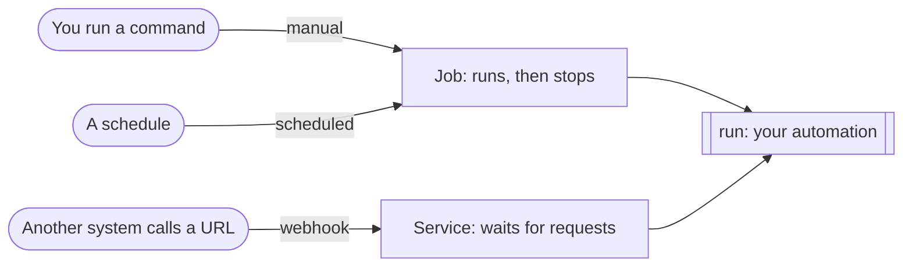
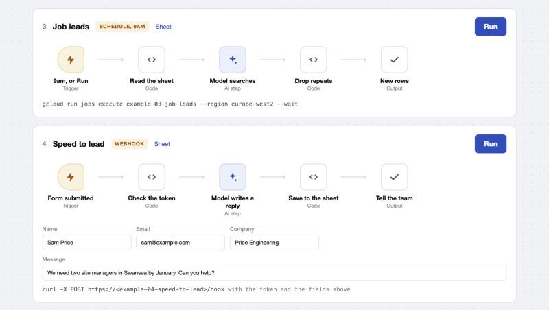

# Build Professional AI Automations

Business automations of the kind people build in n8n, written as short Python scripts that run on Google Cloud Run.

Six working examples: a hello world started three ways, then four real automations for a business. Each one is a single short file.

## The idea

An automation is a function called `run`. The last line of the file picks what starts it.

```python
from toolkit import triggers

def run() -> dict:
    return {"message": "Hello, world!"}

if __name__ == "__main__":
    triggers.job(run)        # or: triggers.webhook(run)
```



There are no API keys. On Cloud Run everything signs in as a service account, including the model, which is Gemini on Vertex AI.

## The examples

| File | What it does | Trigger | AI |
|---|---|---|---|
| [`01-hello_job.py`](examples/01-hello_job.py) | Says hello | Manual, and a schedule | None |
| [`02-hello_webhook.py`](examples/02-hello_webhook.py) | Says hello to whoever calls it with the right token | Webhook | None |
| [`03-job_leads.py`](examples/03-job_leads.py) | Finds new job adverts and adds them to a sheet | Schedule, 9am | One model call |
| [`04-speed_to_lead.py`](examples/04-speed_to_lead.py) | Saves a website enquiry to a sheet with a personal reply already written | Webhook | One model call |
| [`05-receipts.py`](examples/05-receipts.py) | Reads each new receipt in a Drive folder into a row in a sheet | Schedule, every 15 minutes | One model call |
| [`06-video_to_content.py`](examples/06-video_to_content.py) | Turns a new video in a Drive folder into the content drafts that suit it | Schedule, every 15 minutes | An agent |

Read them in order. Each one adds one idea to the one before.

[`examples/toolkit/`](examples/toolkit/) is the shared code, five short files:

| File | What it gives you |
|---|---|
| [`triggers.py`](examples/toolkit/triggers.py) | `triggers.job(run)` and `triggers.webhook(run)` |
| [`sheets.py`](examples/toolkit/sheets.py) | `sheets.read(tab)` and `sheets.add(tab, row)` |
| [`drive.py`](examples/toolkit/drive.py) | `drive.new_files(folder, ...)`, `drive.download(id)`, `drive.mark_done(id)` |
| [`ai.py`](examples/toolkit/ai.py) | `ai.ask(prompt, ...)` for one model call, `ai.transcribe(recording)`, `ai.agent(...)` for an agent with tools |
| [`web.py`](examples/toolkit/web.py) | `web.follow(link)` and `web.notify(text)` for Slack |

## Get started

You need a Google Cloud project with billing on, the [gcloud CLI](https://cloud.google.com/sdk/docs/install) and [uv](https://docs.astral.sh/uv/).

1. Get the code and create your settings file.

```
git clone https://github.com/the-ai-engineer/workshops.git
cd workshops/business-automations
cp .env.example .env
```

2. Open `.env`. Set `PROJECT` to your project id and `WEBHOOK_TOKEN` to any long random text.

3. Sign in and deploy. The first run takes about four minutes.

```
gcloud auth login
gcloud config set project your-project-id
./deploy-examples.sh
```

The script builds one container, deploys every example, and prints a command to try each one. It also prints the email address of the service account the examples run as.

4. Run hello world, then read what it logged. Logs take up to half a minute to arrive.

```
gcloud run jobs execute example-hello --region europe-west2 --wait
gcloud logging read 'resource.labels.job_name="example-hello" AND textPayload:Hello' --freshness 15m --format 'value(timestamp, textPayload)'
```

That covers examples 01 and 02. The other four need a sheet and two folders.

## Set up the sheet and folders

1. Create a Google Sheet with four tabs: `Job leads`, `Enquiries`, `Expenses` and `Content`.
2. Create two Google Drive folders, one for receipts and one for videos.
3. Share the sheet and both folders, as Editor, with the service account email the deploy script printed.
4. Put the three ids in `.env` as `SHEET_ID`, `RECEIPTS_FOLDER_ID` and `VIDEOS_FOLDER_ID`. An id is the long part of the sheet's or folder's address.
5. Deploy again.

## Run the examples

```
gcloud run jobs execute example-03-job-leads --region europe-west2 --wait
gcloud run jobs execute example-05-receipts --region europe-west2 --wait
gcloud run jobs execute example-06-video-to-content --region europe-west2 --wait
```

For receipts and video, drop a file into the folder first. The two webhooks are called with `curl`. The deploy script prints the exact commands.

## A control panel

[`ui/`](ui/) is a small page that draws each automation as a flow with a Run button, the way a no-code tool would. It runs on your own machine. A button on a job runs `gcloud run jobs execute`, and a button on a webhook sends the request.



```
uv run python ui/app.py
```

Then open http://127.0.0.1:8765.

## Get an email when a run fails

```
ALERT_EMAIL=you@example.com ./alerts.sh
```

One rule covers every example. A new rule takes a few minutes to start watching, so wait about five minutes before you test it.

## When you're done

The deploy script puts four jobs on a schedule, and they keep running until you pause them:

```
gcloud scheduler jobs list --location europe-west2
gcloud scheduler jobs pause example-hello-every-5-minutes --location europe-west2
```

## If something goes wrong

| What you see | What to do |
|---|---|
| `NOT_FOUND ... in project` followed by the wrong project | Run `gcloud config set project your-project-id`, or add `--project your-project-id` to the command |
| `Reauthentication failed` | Run `gcloud auth login` again |
| The logs command prints nothing | Logs take up to half a minute. Run it again |
| A webhook returns 403 before your code runs | Your Google organisation blocks public URLs. Add `-H "Authorization: Bearer $(gcloud auth print-identity-token)"` to the curl command |
| Receipts or video does nothing | The file in the folder was already handled. Drop in a new one |
| A job fails with a 403 or 404 from Sheets or Drive | The sheet or folder is not shared with the service account, or its id in `.env` is wrong |

## Test

```
uv sync
uv run pytest
```

The tests use a fake sheet, a fake Drive folder and a fake model, so they need no Google account.

## Add your own

Copy the example closest to what you need, change what `run` does, and add one line for it at the bottom of `deploy-examples.sh`. Use a model for a step that needs judgement, such as reading, writing or searching. Use plain code for everything else.

## Other ways to do this

A job on Cloud Run with a scheduler is one way to run an automation. These are the others worth knowing.

| Kind | Options | Reach for it when |
|---|---|---|
| The same idea on another cloud | [AWS Lambda](https://docs.aws.amazon.com/lambda/latest/dg/welcome.html) with [EventBridge Scheduler](https://docs.aws.amazon.com/scheduler/latest/UserGuide/what-is-scheduler.html), [Azure Container Apps jobs](https://learn.microsoft.com/en-us/azure/container-apps/jobs) | The business is on AWS or Azure. A Lambda function is stopped at 15 minutes |
| Workflow services: the steps go in a config file | [Google Cloud Workflows](https://docs.cloud.google.com/workflows/docs/overview), [AWS Step Functions](https://docs.aws.amazon.com/step-functions/latest/dg/welcome.html), [Azure Logic Apps](https://learn.microsoft.com/en-us/azure/logic-apps/logic-apps-overview) | A run has to wait hours or days for a person or another system |
| Durable execution: the steps are code, saved as they finish | [Temporal](https://temporal.io/), [Inngest](https://www.inngest.com/), [Trigger.dev](https://trigger.dev/), [Cloudflare Workflows](https://developers.cloudflare.com/workflows/) | A long process should carry on from the step that failed |
| Data pipeline schedulers | [Apache Airflow](https://airflow.apache.org/), [Prefect](https://www.prefect.io/) | You have dozens of jobs that feed each other |

The examples here need none of them. Each is one short job that is safe to run twice. Add one when a run has to wait, or has to pick up where it left off.
